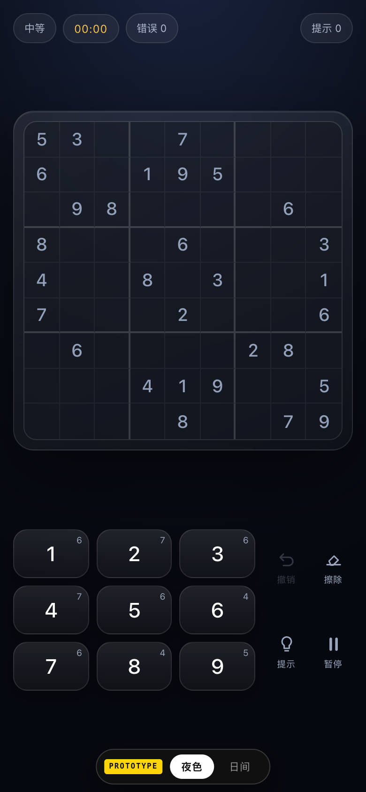
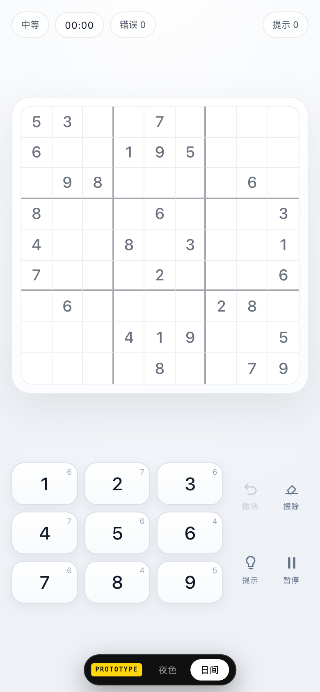
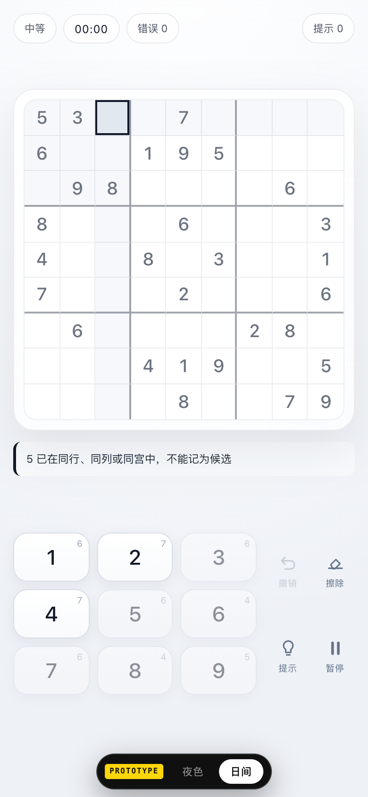

# 数独 · UI 原型（一次性）

**要回答的问题**：这局数独在手机上应该长什么样、手感如何？

**当前方向**：以夜色为基准，日间是白色皮肤；**九键（3×3）定稿**；轻点数字记笔记、长按数字填答案、长按擦除清空全部笔记。界面上不放假说明文字——顶部长条、键盘图例、底部状态行都已删掉。

## 跑起来

```bash
pnpm prototype
```

终端会打印本机与局域网地址。手机与电脑连同一个 Wi-Fi，用手机打开局域网地址即可。也可以直接双击 `index.html`。

默认跟随系统主题；手动切换后会记住。URL 直达：`?theme=night`、`?theme=day`（优先级最高，用于预览）。旧的 `?variant=C` 会落到日间，`?variant=B` 落到夜色。

## 界面只剩这些

- 顶部四个数据胶囊：难度、计时、错误、提示。
- 棋盘。
- 按需出现的状态/提示条（正常时不存在）。
- 九键 + 右侧 2×2 工具（撤销 / 擦除 / 提示 / 暂停）。
- 底部主题切换，以及一个很小的 `PROTOTYPE` 标记。

**没有**常驻图例、没有顶部说明条、没有调试状态行。

## 九键布局

- 3×3：390px 下每键 **81×52**，320px 下 **66×44**，都达到 44pt。
- 工具 2×2 在键盘右侧；390/375/360/320 在带提示条时都不需要滚动。
- 短屏棋盘会缩到 90%（≤700px 高）或 82%（≤620px 高）。
- 单排 9 键已经替换掉，不再是默认布局。

## 两套主题

| 夜色 | 日间 |
| --- | --- |
|  |  |

夜色：深色玻璃、琥珀强调。日间：白色玻璃、石墨强调。

- 首次打开：跟随系统 `prefers-color-scheme`。
- 手动切换：写入 `localStorage`（`sudoku-theme`）和 URL，之后不再被系统覆盖。
- 想恢复跟随系统：清掉 `sudoku-theme` 后刷新；原型没有"自动"按钮。
- 首帧前有一段内联脚本先定主题，避免系统浅色时闪一下夜色。
- 运行中系统主题变化的监听已经写了；Playwright 的 `emulateMedia` 不会派发 `change` 事件，所以这条没在自动化里覆盖。

## 交互

- **轻点数字 = 记/删候选笔记**。选中空格后，同行、同列、同宫中已有的数字会在键盘上变暗；轻点它们只会解释原因，不写入候选。
- **长按数字（450ms）= 填入答案**。变暗的键只是不能记笔记，长按仍然可以填，填错会标红。
- **轻点擦除 = 清当前格；长按擦除（450ms）= 清空整盘候选笔记**。值、错误不动；会提示清掉了几个候选，可撤销。
- **剩余角标含错值**：按盘面上这个数字的实际数量算。填入一个 9（对错都算），9 的角标立刻从 5 变 4；擦除、撤销、替换会同步加回或转移。
- **提示计数第一级 +1**：第一次点提示（高亮/解释）就计数，再点揭示不重复计数。
- 长按过程中键底/工具底有一根 450ms 的进度条；松手时的 click 会被吞掉，不会额外记一笔笔记或触发一次擦除。下一个手势立刻恢复正常。
- 落子（对错都算）会清掉同行、同列、同宫以及本格里这个数字的候选；撤销连候选一起恢复。
- **震动**：填对（短）、填错（两下）、擦除/清笔记、胜利各有一组 `navigator.vibrate`。Android 有效，iOS/Safari 静默降级；原型没有震动开关。
- **音效未加入原型**：正式版会做在设置里（建议默认关），避免原型默认出声。
- 被划掉的键只变暗（`opacity: .45`），没有删除线。
- 提示会先选中目标格并说明技巧，例如"R5C5 只剩 5 可填 · 长按 5 填入，或再点提示揭示"。

键盘（桌面测试用）：`1–9` 轻点记笔记，`Shift+1–9` 填入，`Backspace` 擦除，`Shift+Backspace` 清空全部笔记，`Z` 撤销，`H` 提示，空格暂停，`←/→` 或 `T` 切主题，`Esc` 取消选中。

## 验证记录

2026-10-19，在 Chromium（Playwright，真实 pointer 事件）里跑：

- 清理后的界面：无顶部说明条、无键盘图例、无状态行；只剩顶部数据、九键、工具、主题切换和小 `PROTOTYPE` 标记。
- 九键：390 / 375 / 360 / 320 四档下键位分别为 81×52、81×48、77×48、66×44；带提示条时四档都不需要滚动，键盘与切换器不重叠。
- 主题：浅色系统首次加载→日间；清空存储 + 深色系统→夜色；手动选日间后刷新仍是日间；`?theme=night` 覆盖为夜色。
- 被划掉的键：`opacity: .45`，`text-decoration-line: none`。
- R1C3 长按 9（错）：9 的角标 5→4，错误 +1；撤销后角标回到 5。
- R1C7 长按 9（对）：9 的角标 5→4；轻点擦除该格后角标回到 5。
- R1C3 / R2C2 共 4 个候选，长按擦除：全部清空，提示"已清除全部笔记（4 个候选）· 可撤销"；撤销恢复。
- 选中一个已填值的格子再长按擦除：值保留（松手 click 没有触发擦除该格）；随后立刻轻点 4，正常记笔记。
- 点提示：选中 R5C5，提示"长按 5 填入"；长按 5 填入，提示计数为 1。
- 长按被变暗的 5：仍然填入并标红，松开没有触发"先擦除"的笔记提示。
- 暂停 / 继续正常。
- 震动无法在无头 Chromium 中验证；Android 真机可感。

截图：[角标 9 从 5 → 4](screenshots/day-badge9.png) · [长按擦除提示](screenshots/day-clear-notes.png)

日间拦截候选：



## 看的时候留意

- **没有常驻教学**：图例删掉后，轻点/长按/长按擦除都不可见；正式实现需要首次 3 秒引导或设置里的手势说明，不能只靠玩家自己试。
- **九键的代价**：短屏棋盘会缩小，但四档尺寸下带提示条都不需要滚动。
- **主题恢复**：手动选择会记住；想回到"跟随系统"需要清 `localStorage`，原型没有自动按钮。
- **音效**：这版只有震动；音效建议和正式版设置页一起做（默认关）。
- **角标语义**：现在按盘面实际数量算，填错也减；如果只想统计正确落子，需要改。
- **工具区**：撤销 / 擦除 / 提示 / 暂停，2×2 在九键右侧；暂停从顶部移到了这里。

## 这是一次性代码

正式实现会沿用这里的主题变量、九键布局与交互规则，但重写引擎、生成器、存档与 PWA 外壳。原型里的底部主题切换器、`PROTOTYPE` 标记、调试钩子不会进入正式版。
